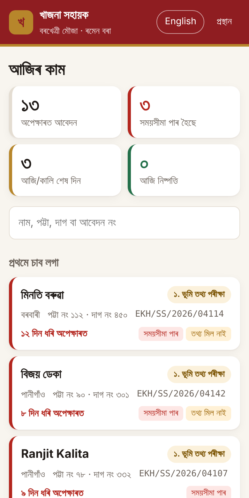
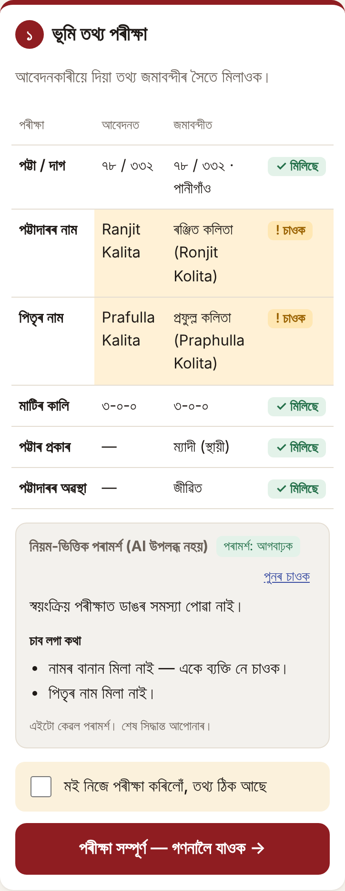
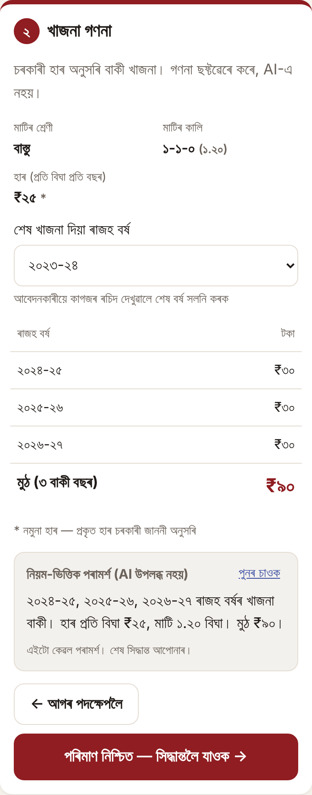
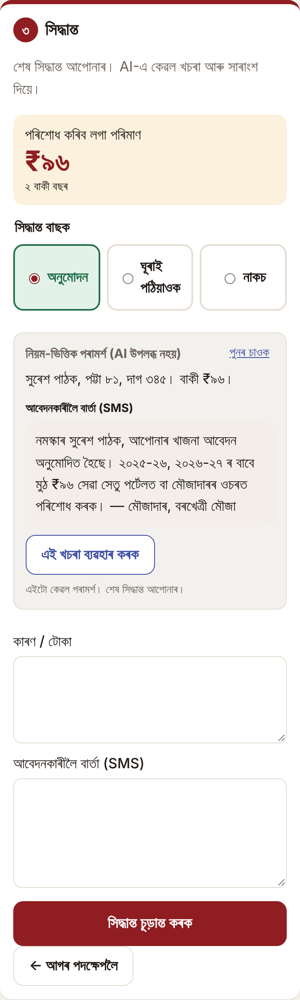

# খাজনা সহায়ক · Khajna Sahayak

**An Assamese-first workflow tool for Mouzadars processing e-Khajana (land revenue) applications.**

A Mouzadar opens the app on a phone, sees which applications need attention first, and takes each one through three steps: **land record check → dues calculation → decision**. AI helps at each step, but the Mouzadar makes every decision, and every action goes into the application's history.

| Dashboard | Step 1 · Record check | Step 2 · Dues | Step 3 · Decision |
|---|---|---|---|
|  |  |  |  |

**Live demo:** https://khajna-sahayak.onrender.com · **Login:** `mouzadar` / `khajna2026`
The free server sleeps when idle, so the first load can take ~30 seconds. The interface is in Assamese by default. Use the **English** button in the top bar to switch languages.

---

## 1. The problem and who it affects

**Khajna (খাজনা)** is the annual land revenue every landowner (*pattadar*) in Assam pays. In rural areas the revenue is collected by a **Mouzadar**, a government-appointed collector responsible for a *mouza* (a group of villages). Since 2023 citizens can apply to pay online through **e-Khajana on the Sewa Setu portal**, and offline payment through the Mouzadar has since been allowed again. Mouzadars therefore handle both portal applications and paper ones.

To understand how this works in practice, I spoke with a relative who is a practising Mouzadar. Each application has to be checked **personally by the Mouzadar** on the portal before the citizen can pay. For every application he:

1. finds the **patta** (holding) and **dag** (plot) in the **Jamabandi** (record of rights) and checks that the name, father's name and area match;
2. works out **how many revenue years are unpaid** and the amount at the government rate for that land class;
3. enters the demand, or sends the application back or rejects it.

Where it breaks down:

- **Backlog.** Applications sit with status *"Pending with LM/Mouzadar"* for weeks. Citizens can't pay, can't get land documents that require a clear khajna receipt, and end up travelling to the Mouzadar in person.
- **Messy data.** Names are typed in English or Assamese with many spellings (*Ranjit/Ronjit, Kalita/Kolita*), dag numbers are mistyped, the pattadar may have died with the heir applying, and arrears can go back ten years or more. Each of these needs judgement, and each takes time.
- **Poor feedback to citizens.** A returned or rejected application often carries no clear reason, so the citizen reapplies with the same mistake.

**Who it affects:** the Mouzadar (and Lot Mandals and Circle Office staff, who handle similar files), and the landowners in every rural mouza, many of them elderly farmers who depend on a clean khajna receipt for loans, mutation and land sales.

## 2. What the application does

**Dashboard: what needs attention first.** It shows counts for pending, past deadline, due today/tomorrow and disposed today. Pending applications are ranked by a simple, explainable score:

1. past the service deadline (default 7 days, configurable),
2. due in a day or less,
3. has a record mismatch that will need action anyway,
4. has many years of arrears,
5. then by age.

Each card shows *why* it is near the top (e.g. "past deadline", "record mismatch"). It also has search by name, patta, dag or application number.

**The workflow (three steps plus the decision):**

| Step | What the worker does | What the software does | What AI adds |
|---|---|---|---|
| **১. ভূমি তথ্য পৰীক্ষা: Land record check** | Compares the application with the Jamabandi, then ticks "I have checked this myself" | Looks up patta + dag and runs deterministic checks (name, father's name, area, patta type, pattadar alive/deceased), marking each one ✓ matches / ! check / ✕ mismatch. If the dag isn't found, it lists the dags that *do* exist under that patta | Judges whether a mismatch is real: *"Ranjit Kalita" and "ৰঞ্জিত কলিতা (Ronjit Kolita)" are the same person*; *pattadar deceased, applicant's father = pattadar → likely heir, accept khajna but advise mutation (নামজাৰী)*; *dag 450 doesn't exist, 451 does → return for correction*. Suggests proceed / return / reject |
| **২. খাজনা গণনা: Dues calculation** | Confirms the amount; changes the "last paid year" if the citizen shows a paper receipt (common now that offline payment is back) | Calculates the unpaid revenue years (July–June) × area in bigha (B-K-L) × rate for the land class. It flags *nothing due*, *6+ years unpaid*, *never paid* and *large amount* | Explains the amount in plain Assamese the Mouzadar can read out to the citizen, and points out anything unusual. **It never computes or changes the money** |
| **৩. সিদ্ধান্ত: Decision** | Chooses **Approve / Return / Reject**, edits the note and the SMS, and finalises | Approval generates a demand/receipt number. Reject and Return require a written reason. Approval is blocked if nothing is due | Drafts the file note and an SMS to the citizen for the chosen action, e.g. exactly what to correct. The worker clicks "Use this draft", edits it, and submits |

- **Return or reject from any step.** If the record is clearly wrong at step 1, the worker doesn't have to click through the rest.
- **Go back a step.** For example, if the worker spots a problem while deciding.
- **History.** Every action is logged with its time, who did it, the from → to status, the note, and whether an AI draft was used. Finished applications show the decision, note, SMS and receipt number, and can be printed.

## 3. Where AI helps, and why only there

I used AI only where the work is **judgement over messy text in two scripts**, and kept it out of anything that must be exact:

| Used for | Why AI | Not used for | Why not |
|---|---|---|---|
| Deciding whether two differently spelled or scripted names are the same person | Rules can't reliably handle Assamese ↔ English transliteration and spelling variants. A model does this well and explains its reasoning | Calculating khajna | Money must be exact, reproducible and auditable, so plain code with unit tests handles it |
| Recognising patterns (heir applying, mistyped dag, annual patta) and suggesting next steps | This is the experience a new or overloaded Mouzadar lacks | Changing an application's status | The worker always clicks the button. The AI has no write access |
| Writing clear Assamese explanations, file notes and citizen SMS | This is the slowest part for a busy worker, and it directly fixes the "no reason given" problem | Ranking the queue | The ranking needs to be explainable ("past deadline"), so it uses a transparent score |

Design safeguards:

- **The human makes the decision.** AI output appears in a clearly marked card ("AI suggestion — the final call is yours"). Drafts only enter the form when the worker clicks *Use this draft*, and they stay editable.
- **Deterministic checks always run.** AI adds judgement on top of the checks and never replaces them.
- **Graceful fallback.** If the model is down, slow (20 s timeout) or returns invalid JSON, a **rule-based suggestion** is shown, labelled as such. The worker is never blocked, and the app works with no API key at all.
- **Minimal data.** The model gets only what each task needs. Phone numbers are never sent.
- **Auditable and cheap.** Every suggestion is stored (`ai_outputs`) with its input hash and source, and reused until the input changes. History records whether an AI draft was used in each decision.
- **Structured output.** The model returns JSON with a fixed shape (verdict, summary, concerns, note, SMS), which is validated and length-limited before display.

The model is **Google Gemini** (`gemini-3.5-flash` by default, configurable). Model names change and free-tier models are often busy, so the client retries busy models, skips models without quota, and can discover available flash models from the API; `/healthz` shows which model answered last. It handles Assamese well, has a free tier suited to a pilot, and is fast enough to use on a phone.

## 4. How I would measure impact, and why I think it will work

**Main metric: time from application to the Mouzadar's decision (median and 90th percentile), and the share decided within the service deadline.** This is the delay citizens actually feel, and the app's database already records every timestamp needed to measure it.

| Metric | How it's measured | What success looks like |
|---|---|---|
| Time to decision | `submitted` → final event in `events` | Median falls from weeks to a few days. Past-deadline count trends towards zero |
| Worker time per application | Time between the first view and the decision event (add page-view logging) | A clean case takes under 2 minutes |
| Quality of returns | % of returned applications resubmitted correctly the *first* time | Rises, because the SMS states exactly what to fix |
| Repeat applications / visits | Same patta + dag applying more than once in a year | Falls |
| AI usefulness | % of decisions where the AI draft was used (logged), how much it was edited, and agreement between the AI verdict and the worker's decision | High use with light edits means it helps. Frequent disagreement shows which prompts need work |
| Safety | Decisions reversed later by the Circle Office, and complaints | Must not rise compared with before the pilot |
| Revenue | Khajna collected per mouza per quarter | Rises as the backlog clears and arrears are surfaced |

**Pilot plan:** start with 2–3 mouzas in one revenue circle, collect 4 weeks of baseline data from the portal, then run 8 weeks with the tool and compare against similar mouzas that don't use it. Alongside the numbers, spend a short weekly session with the Mouzadars looking at the cases where they disagreed with the AI.

**Why I think it will work:**

- It speeds up the parts that are slow today (looking things up, comparing names and areas, counting years, writing the reason) and leaves the actual decision with the person accountable for it.
- The dashboard turns "a long list of pending items" into "do these three first", which attacks the deadline problem directly.
- Clear return reasons reduce rework for both sides.
- It is Assamese-first, has large touch targets, works on a cheap phone, and needs no training beyond "tick, confirm, decide".

## 5. Main technical decisions

- **Server-rendered pages (Express + EJS) with a little progressive JavaScript.** Field workers use low-end Android phones on patchy mobile data. Plain HTML pages load fast, and **every workflow action is an ordinary form post that works without JavaScript**. JS is only used for the AI cards and small conveniences. I chose this over a SPA framework deliberately.
- **TypeScript, with domain logic in pure modules:**
  - `src/khajna.ts`: money and revenue years, no I/O, unit-tested
  - `src/checks.ts`: deterministic record checks and name normalisation for Latin and Assamese script
  - `src/workflow.ts`: the state machine. Each transition is validated and **writes its history event in the same database transaction**, so the history is complete by construction
  - `src/ai.ts`: prompts, Gemini client, validation, rule-based fallback and caching
- **SQLite (better-sqlite3).** Zero setup, transactional, and more than enough for a single mouza. Moving to Postgres is a driver change because the SQL is plain. On the free hosting tier the disk is temporary, so **demo data reloads automatically** when the server restarts, which means reviewers always start from a clean state.
- **Internationalisation.** All UI text lives in `src/i18n.ts`, with Assamese as primary and English as secondary. Numbers are shown in Assamese digits (০–৯) in Assamese mode. The font is Noto Sans Bengali, which covers the Assamese-specific letters ৰ and ৱ.
- **Auth.** Passwords are hashed with scrypt, and sessions use an HMAC-signed, httpOnly cookie. Every query is scoped to the logged-in Mouzadar's mouza.
- **Configurable assumptions:** the service deadline (`SLA_DAYS`), the model (`GEMINI_MODEL`) and the rate table (`RATES_PER_BIGHA`).

### Assumptions and limitations (honest list)

- **All people, pattas and dags are fictional.** The Jamabandi is simulated. In production it would be read from Dharitree/ILRMS rather than copied.
- **The khajna rates are illustrative.** Real rates are notified by the Revenue & DM Department and vary by district and land class. They would be loaded from the official notification for each mouza, with an effective date.
- The 7-day deadline is a placeholder for the timeline notified for the service.
- Not modelled: payment itself (it happens on Sewa Setu/treasury), penalties and interest, partial payments, and Lot Mandal/Circle Officer roles.
- **Next steps:**
  - entry form for paper applications
  - offline mode (PWA) for areas with poor connectivity
  - actually sending the SMS through an SMS gateway
  - voice input for notes
  - a Circle Officer view across mouzas

## 6. Run it locally

Requirements: **Node.js 22+**.

```bash
git clone https://github.com/nilabhnahideka/khajna-sahayak.git
cd khajna-sahayak
npm install
cp .env.example .env        # optional: add GEMINI_API_KEY for real AI suggestions
npm run dev                 # http://localhost:3000
```

Log in with `mouzadar` / `khajna2026`. Without a Gemini key the app still works and shows rule-based suggestions.

| Command | What it does |
|---|---|
| `npm run dev` | Start with auto-reload |
| `npm test` | Unit tests for dues calculation, revenue years, land measures and name matching |
| `npm run build && npm start` | Production build and start |
| `npm run seed` | Wipe the database and reload the demo data |

**Deploy (Render):** the repo includes `render.yaml`. Create a new Blueprint from the repo and set `GEMINI_API_KEY` when prompted.

### Demo cases worth trying

| Applicant | What it shows |
|---|---|
| Ranjit Kalita | English vs Assamese name with a different romanisation, which AI recognises as the same person |
| মিনতি বৰুৱা | Dag 450 doesn't exist (451 does). Return with a clear correction SMS |
| বিজয় ডেকা | The pattadar has died and his son applies. Heir detection and mutation advice |
| কমলা নাথ | 10 years of arrears, flagged |
| পূৰ্ণিমা গগৈ | Already paid for this year: nothing due, so approval is blocked |
| Dhanjit Choudhury | Trade-site land with a large amount, flagged to double-check the land class |
| নয়নমণি বৰা / সুৰেশ পাঠক | Already at step 2 / step 3 |
| Disposed cases | Full history of approved, returned and rejected applications |

## Project structure

```
src/
  server.ts      routes, view helpers
  workflow.ts    state machine, queue ranking, history
  khajna.ts      dues calculation (pure)
  checks.ts      record checks, name normalisation (pure)
  ai.ts          Gemini prompts, validation, fallback, cache
  i18n.ts        Assamese + English strings
  auth.ts        password hashing, signed sessions
  db.ts, seed.ts schema and fictional demo data
views/           EJS templates
public/          CSS and the small client script
test/            unit tests
```
